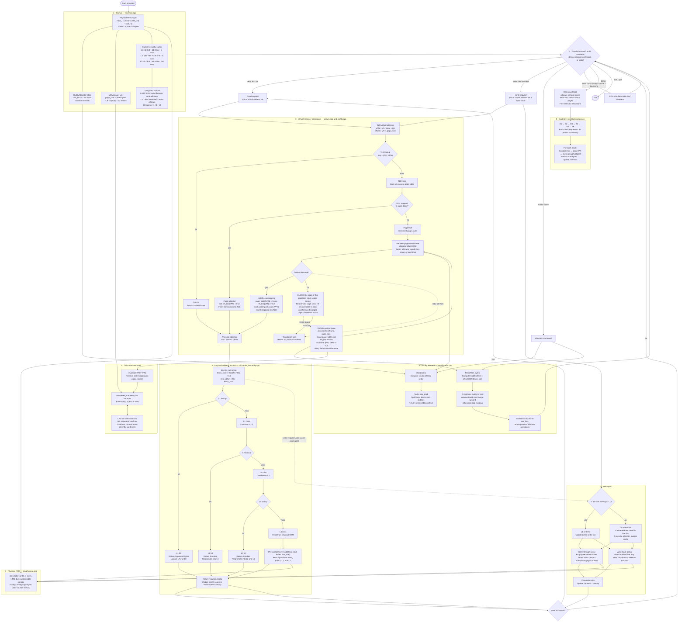

# Memory Hierarchy Simulator

A modular **C++17 memory-system simulator** that brings together virtual-address translation, a TLB, demand paging, CLOCK-like page replacement, buddy allocation, physical RAM, and a configurable L1/L2/L3 cache hierarchy.

> **Explore the system:** GitHub renders the Mermaid architecture below directly in this README. Expand the sections further down for setup, commands, design notes, and an example access trace.

<p align="center">
  
  
  
  
</p>

## Contents

- [System architecture](#system-architecture)
- [How an access works](#how-an-access-works)
- [Configuration](#configuration)
- [Build and run](#build-and-run)
- [Interactive command reference](#interactive-command-reference)
- [Project structure](#project-structure)
- [Implementation notes and limitations](#implementation-notes-and-limitations)

## System architecture

The diagram follows the system from startup and creation of **1 MiB of zero-initialized physical memory**, through virtual-address translation and allocation, into the cache hierarchy. The six blocks `B1`–`B6` are an illustrative sequence of memory accesses—not a claim that every access misses.



<details>
<summary><strong>Read the diagram: key variables</strong></summary>

| Variable | Meaning |
|---|---|
| `ram_bytes` | Total simulated physical RAM: `1 << 20` bytes (1 MiB) |
| `page_size` | Virtual-memory page size: 4096 bytes (4 KiB) |
| `min_block` | Minimum buddy-allocation block: 64 bytes |
| `VA` | Virtual address supplied by the workload |
| `VPN` | Virtual page number: `VA / page_size` |
| `offset` | Offset inside the page: `VA % page_size` |
| `frame` | Physical frame base offset returned by the allocator |
| `PA` | Physical address returned by `VMManager::translate()`; in this implementation it is `frame + offset` |
| `page_table` | Per-process map from VPN to allocated frame offset |
| `ref_bits` | Per-page reference bits used by CLOCK-like eviction |
| `clock_order` | Deque used to scan and rotate candidate virtual pages |
| `mem_` | The actual byte array representing physical RAM |
| `block_start` | Start address of the cache line containing a physical address |
| `byte_offset` | Position within a cache line |
| `free_lists_` | Buddy allocator's free blocks grouped by allocation order |

</details>

## How an access works

<details>
<summary><strong>1. Startup and memory creation</strong></summary>

The program creates four shared objects:

- `PhysicalMemory pm(1 << 20)`: a 1 MiB zero-initialized byte vector.
- `BuddyAllocator alloc(ram_bytes, 64)`: tracks free blocks in power-of-two orders.
- `VMManager vm(pm, alloc, 4096, 32)`: translates addresses and uses a 32-entry TLB.
- `CacheHierarchy cache(pm, l1, l2, l3)`: all cache levels use the same physical-memory object.

The allocator and virtual-memory manager share the same physical address space. The cache hierarchy reads from and writes to that same RAM object.

</details>

<details>
<summary><strong>2. TLB, page table, and page fault</strong></summary>

For a virtual address `VA`, the manager calculates:

```cpp
vpn    = VA / page_size;
offset = VA % page_size;
```

It first looks up `(PID, VPN)` in the TLB. On a TLB miss, it checks the process's page table. If the mapping exists, it updates the reference bit and inserts the mapping into the TLB. If the mapping is absent, it records a page fault and—when allocation on fault is enabled—requests a page-sized allocation.

If allocation fails, the implementation scans the **current process's** CLOCK deque, reclaims a victim if possible, and retries allocation once. A TLB hit returns directly from the cached mapping; it does not currently update the page's CLOCK reference bit.

</details>

<details>
<summary><strong>3. L1 → L2 → L3 → RAM</strong></summary>

A cache line is 64 bytes by default. The hierarchy checks L1 first, then L2, then L3, and finally physical RAM. A hit at a lower cache level fills/promotes data into upper levels; an L3 miss causes a physical-memory read. The configured cache hit latencies are 1, 4, and 12 units, and RAM accesses add a modeled 100 units.

For the six-block illustration, every block can have a different outcome. Repeated accesses may hit in a cache; conflicting addresses may evict one another. The actual result depends on the addresses and the cache's set mapping.

</details>

<details>
<summary><strong>4. Buddy allocation and coalescing</strong></summary>

The buddy allocator groups free blocks by power-of-two size. An allocation searches for a suitable free block and splits a larger block as needed. When a block is freed, the allocator checks whether its buddy is also free; if so, it merges the pair and continues upward.

The buddy address is calculated with XOR against the block size. The allocator uses a mutex around allocation and deallocation operations.

</details>

## Configuration

| Component | Configuration | Behavior |
|---|---|---|
| Physical RAM | 1 MiB | Zero-initialized `std::vector<uint8_t>` |
| Virtual memory | 4 KiB page | On-demand mapping and page-fault accounting |
| TLB | 32 entries | LRU; key includes PID and VPN |
| L1 cache | 32 KiB, 64 B lines, 4-way | LRU, write-through, write-allocate, hit latency 1 |
| L2 cache | 256 KiB, 64 B lines, 8-way | LRU, write-through, write-allocate, hit latency 4 |
| L3 cache | 512 KiB, 64 B lines, 16-way | LRU, write-back, write-allocate, hit latency 12 |
| Buddy allocator | Minimum block 64 B | Power-of-two splitting and coalescing |

Cache capacities and policies are initialized in `src/main.cpp`. These are simulation settings, not a claim about the exact cache configuration of a real CPU.

## Build and run

Requirements: a C++17 compiler and GNU Make.

```sh
make
./sim
```

To rebuild from scratch:

```sh
make clean
make
./sim
```

## Repeatable benchmarks

Build and run the benchmark executable separately from the interactive simulator:

```sh
make bench
./bench
```

The benchmark runs seven deterministic workloads against four cache configurations (28 combinations total). Every combination starts with fresh simulated RAM, allocator, VM, TLB, and caches, so previous cases do not contaminate later counters.

| Workload | Pattern | What it helps investigate |
|---|---|---|
| `sequential_stream` | Sequential 64-byte cache-line strides across a 64-page region | Streaming access behavior |
| `small_hot_set` | Repeated accesses within an 8-page working set | Temporal locality and cache reuse |
| `deterministic_random` | Seeded pseudo-random line accesses across 64 pages | Less predictable locality |
| `mixed_read_write` | Deterministic line accesses with every fourth operation a write | Read/write behavior under the current write policy implementation |
| `multi_process_hot_set` | Two PIDs alternate accesses to the same virtual-address working set | Per-process virtual mappings and TLB behavior under interleaved processes |
| `page_pressure_300_pages` | Cycles through 300 virtual pages in 1 MiB of physical RAM | Page faults, frame reclamation, and CLOCK-like eviction under memory pressure |
| `associativity_probe` | Reuses eight virtual pages at a regular stride | How regular address strides and physical frame placement interact with cache set mapping; interpret alongside the recorded counters |

| Configuration | L1 | L2 | L3 | Replacement |
|---|---|---|---|---|
| `baseline` | 32 KiB, 4-way | 256 KiB, 8-way | 512 KiB, 16-way | LRU |
| `small_l1` | 4 KiB, 2-way | 64 KiB, 4-way | 256 KiB, 8-way | LRU |
| `larger_caches` | 64 KiB, 8-way | 256 KiB, 8-way | 512 KiB, 16-way | LRU |
| `fifo` | 32 KiB, 4-way | 256 KiB, 8-way | 512 KiB, 16-way | FIFO |

The command prints a summary table and writes detailed rows to `benchmark_results.csv` in the current working directory. L1 counters count top-level cache lookups once, including write misses; lower-level counters represent the lookups reached after an upper-level miss. A write-allocate fill no longer double-counts its internal L1 lookup. The CSV includes operation counts, TLB hits/misses and hit rate, page faults and evictions, cache-level hits/misses and hit rates, memory accesses, writebacks, total modeled latency, and host runtime in milliseconds.

**Metric interpretation:** hit rate is calculated from the simulator's recorded lookup counters. The current cache implementation can perform an additional cache lookup when a write miss triggers line fill, so cache-level lookup counts are not necessarily one lookup per top-level operation. `total_modeled_latency` is the simulator's configured latency model—not measured CPU cycles. `runtime_ms` is actual host wall-clock runtime and can vary with machine load and compiler settings. Compare runs under the same build and environment; do not describe modeled latency as real hardware speedup.

For a repeatable local run, use a fresh build and save the terminal output alongside `benchmark_results.csv`:

```sh
make clean
make bench
./bench
```

## Interactive command reference

Start `./sim`, then enter commands in the terminal.

| Command | Example | Description |
|---|---|---|
| `help` | `help` | Show supported commands |
| `demo` | `demo` | Run allocation, translation, write, reread, and free operations |
| `read` | `read 1 1000` | Translate a hexadecimal virtual address and read one byte |
| `write` | `write 1 1000 42` | Translate a hexadecimal virtual address and write a byte value |
| `malloc` | `malloc 128` | Allocate a block of the requested size |
| `free` | `free 0 128` | Free a block using its offset and requested size |
| `vm` | `vm` | Show virtual-memory, page-fault, and TLB state |
| `buddy` | `buddy` | Show buddy allocator state |
| `cache` | `cache` | Show cache hierarchy statistics |
| `hierarchy` | `hierarchy` | Show L1/L2/L3 hierarchy statistics |
| `stats` | `stats` | Show allocator, VM, and cache statistics |
| `clear` | `clear` | Clear the terminal |
| `exit` / `quit` | `exit` | Quit the simulator |

**Address format:** the `read` and `write` commands parse the virtual address as hexadecimal. The write value is parsed as an integer and stored as a single byte.

## Project structure

```text
Memory-Hierarchy-Simulator/
├── include/
│   ├── allocator.h
│   ├── cache.h
│   ├── cache_hierarchy.h
│   ├── physical.h
│   ├── tlb.h
│   ├── tui.h
│   └── vm.h
├── src/
│   ├── allocator.cpp
│   ├── cache.cpp
│   ├── cache_hierarchy.cpp
│   ├── main.cpp
│   ├── physical.cpp
│   ├── tlb.cpp
│   └── vm.cpp
├── tests/
│   └── workload.txt
├── docs/
│   └── DESIGN.md
├── Makefile
└── README.md
```

## Implementation notes and limitations

This is a learning-oriented simulator: its counters and modeled latencies help explore memory-system concepts, but they are not cycle-accurate hardware measurements.

- CLOCK-like replacement scans the page table for the process currently faulting; it is not a global replacement policy.
- TLB hits currently bypass the page-reference-bit update, so CLOCK metadata may not reflect every recent access.
- The cache implementation models line fills, replacement, and write policies; validate write propagation, dirty-line eviction, and physical-frame reuse carefully before relying on data-consistency or performance claims.
- The `free` command trusts the supplied offset and size; invalid frees, incorrect sizes, and double frees are not comprehensively guarded.
- The bounds checks in physical-memory reads and writes should be hardened against integer overflow for adversarial inputs.
- The legacy single-cache implementation in `cache.cpp` remains in the project; normal application accesses use `CacheHierarchy`.

## Engineering goals

- Make address translation and page faults observable.
- Demonstrate TLB locality and LRU eviction.
- Explore power-of-two allocation, splitting, and buddy coalescing.
- Compare cache hits, misses, replacement policies, write policies, and modeled latency.
- Keep components modular so individual subsystems can be inspected and improved.

---

**Suggested next experiment:** run `demo`, then inspect `vm`, `buddy`, and `hierarchy`. Repeat a read to the same virtual address and compare the counters.
